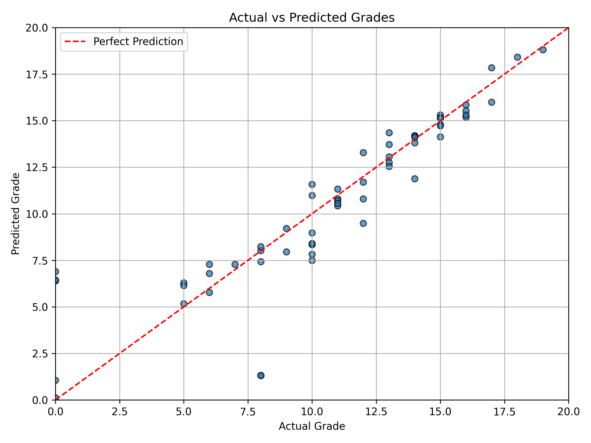
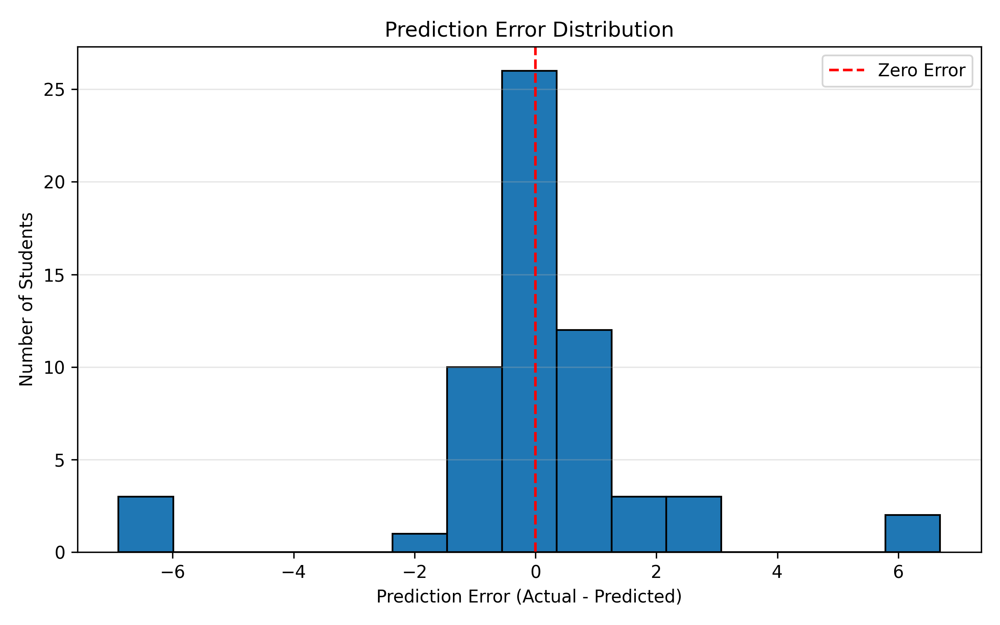

# 🎓 AI 기반 학생 성적 예측 서비스
### Student Performance Predictor

학생의 학습 정보와 이전 성적을 활용하여 최종 성적을 예측하는 머신러닝 웹서비스입니다.

## 0. 프로젝트 정보

- **프로젝트명:** AI 기반 학생 성적 예측 서비스
- **학번:** [202032543]
- **이름:** [변지현]
- **개발 환경:** Google Colab, Python, scikit-learn, Streamlit
- **GitHub URL:** [https://github.com/forjihyuns/student-performance-predictor]
- **Demo URL:** [https://student-performance-predictor-3aryt3ddhnxtf3habf33hd.streamlit.app/]

## 1. 문제 정의

### 1.1 문제 상황 (Who / What / When / Why)

- **Who:** 자신의 학업 성취도를 예측하고 싶은 학생
- **What:** 학습 정보와 이전 성적을 기반으로 최종 성적을 예측하는 서비스
- **When:** 1차·2차 평가 결과가 나온 이후, 최종 성적을 예상하고 싶을 때
- **Why:** 학습 상황을 점검하고 향후 학습 계획을 수립하는 데 참고할 수 있는 정보를 제공하기 위해

### 1.2 기존 서비스와의 차별점

일반적인 성적 조회 서비스가 이미 확정된 성적을 보여주는 데 초점을 맞춘다면, 본 서비스는 머신러닝을 이용하여 아직 확정되지 않은 최종 성적을 예측합니다.

사용자는 이전 성적, 공부 시간, 결석 횟수, 과거 낙제 횟수 등을 입력하고 예측 결과를 확인할 수 있습니다.

### 1.3 정량적 목표

- 테스트 MAE 1.5점 이하
- 테스트 R² 0.75 이상

위 목표는 본 프로젝트의 성능 평가 기준으로 정리한 것입니다. 

## 2. 데이터

### 2.1 데이터 출처

- 데이터셋: UCI Student Performance Dataset
- 제공기관: UCI Machine Learning Repository
- 데이터 URL: https://archive.ics.uci.edu/dataset/320/student+performance
- 라이선스: CC BY 4.0
- 원저자: Paulo Cortez, Alice Silva

### 2.2 데이터 규모 및 구성

- 사용 데이터: 수학 성적 데이터(student-mat.csv)
- 전체 관측치: 395개
- 전체 변수: 33개
- 입력 변수: 32개
- 예측 대상: 최종 성적 G3(0~20점)

주요 변수는 다음과 같습니다.

| 변수 | 의미 |
|---|---|
| G1 | 1차 성적 |
| G2 | 2차 성적 |
| studytime | 주간 공부 시간 구간 |
| absences | 결석 횟수 |
| failures | 과거 낙제 횟수 |
| G3 | 최종 성적(예측 대상) |

### 2.3 데이터 선정 이유

학생의 성적뿐 아니라 학습 시간, 결석 횟수, 학교생활 및 가정환경 관련 변수가 포함되어 있어 다양한 특성과 최종 성적의 관계를 분석하기에 적합합니다.

또한 정형 데이터로 구성되어 있어 여러 회귀 모델의 성능을 객관적으로 비교할 수 있습니다.

### 2.4 데이터 분포


.png)
  


본 프로젝트에서 사용한 데이터는 총 395명의 학생 성적 데이터로 구성되어 있으며, 최종 성적(G3)은 0~20점 범위로 분포한다. 전체 학생의 평균 최종 성적은 **10.42점**, 중앙값은 **11점**으로 나타났다.

성적 구간별 분포를 분석한 결과, **11~15점 구간이 169명(42.8%)으로 가장 높은 비중**을 차지하였으며, 6~10점 구간은 140명(35.4%), 0~5점 구간은 46명(11.6%), 16~20점 구간은 40명(10.1%)으로 나타났다.

전체 학생의 약 78.2%가 6~15점 구간에 분포하고 있어, 최종 성적이 중간 점수대에 상대적으로 집중되어 있음을 확인하였다. 이러한 데이터 분포는 모델이 중간 점수대의 학생을 상대적으로 많이 학습하게 되는 특성이 있으며, 성적 구간별 예측 오차를 추가로 분석할 필요가 있음을 시사한다.


## 3. 데이터 전처리

### 3.1 결측치 처리

`SimpleImputer`를 활용하여 숫자형 변수에는 중앙값, 범주형 변수에는 최빈값을 적용하도록 구성하였습니다.

원본 데이터의 결측치 여부를 확인한 뒤 실제 대체 여부를 분석하였습니다.

### 3.2 범주형 변수 인코딩

`OneHotEncoder`를 사용하여 문자형 범주 데이터를 머신러닝 모델이 처리할 수 있는 숫자형 변수로 변환하였습니다.

### 3.3 수치형 변수 표준화

`StandardScaler`를 사용하여 숫자형 변수의 평균이 0, 표준편차가 1이 되도록 변환하였습니다.

### 3.4 데이터 분할

| 구분 | 비율 | 데이터 수 |
|---|---|---|
| Train | 약 70% | 276개 |
| Validation | 약 15% | 59개 |
| Test | 약 15% | 60개 |

- Random seed: 42
- 테스트 데이터는 모델 학습 및 하이퍼파라미터 선택에 사용하지 않았습니다.
- 전처리 기준은 학습 데이터에서만 계산하였습니다.

### 3.5 전처리 전후 비교


본 프로젝트에서는 결측치 처리, 원-핫 인코딩, 표준화 기법을 적용하였다.

원-핫 인코딩을 통해 범주형 변수를 숫자형 변수로 변환하였으며, 표준화를 통해 숫자형 변수들의 스케일을 조정하였다.

전처리 과정에서 데이터의 행 개수는 유지되었으며, 변환된 데이터는 머신러닝 모델 학습에 활용되었다.


## 4. 모델

### 4.1 베이스라인 모델: Decision Tree Regressor

의사결정나무는 입력 변수의 조건에 따라 데이터를 반복적으로 분할하여 최종 성적을 예측하는 모델입니다.

- 최대 깊이: 5
- Random seed: 42
- 학습 방식: 직접 지도학습

모델의 구조가 직관적이고 비교적 단순하여 베이스라인으로 선정하였습니다.

### 4.2 제안 모델: Random Forest Regressor

랜덤 포레스트는 여러 의사결정나무의 예측을 결합하는 앙상블 학습 모델입니다.

- 초기 나무 개수: 100
- 초기 최대 깊이: 5
- Random seed: 42
- 학습 방식: 직접 지도학습

단일 의사결정나무의 과적합 위험을 완화하고 예측 성능을 개선할 수 있다는 점에서 제안 모델로 선정하였습니다.

### ### 4.3 모델 개선

랜덤 포레스트 모델의 예측 성능을 개선하기 위해 하이퍼파라미터 튜닝을 수행하였다.

주요 하이퍼파라미터인 `n_estimators`(의사결정나무 개수)와 `max_depth`(나무의 최대 깊이)를 변경하며 총 5가지 조합을 실험하였다.

각 모델은 동일한 학습 데이터로 학습하였으며, 검증 데이터(Validation Set)의 MAE를 기준으로 성능을 비교하였다.

**하이퍼파라미터별 성능 비교**

| 나무 개수 (n_estimators) | 최대 깊이 (max_depth) | Validation MAE |
|---:|---:|---:|
| 50 | 3 | 1.073 |
| 100 | 5 | 1.030 |
| 100 | 8 | 1.000 |
| 200 | 5 | 1.013 |
| **200** | **8** | **0.983** |

**최종 선택된 하이퍼파라미터**

- 최종 나무 개수: **200개**
- 최종 최대 깊이: **8**
- 모델 선택 기준: **Validation MAE 최소화**

초기 랜덤 포레스트 모델(n_estimators=100, max_depth=5)의 Validation MAE는 1.030이었으나, 하이퍼파라미터 튜닝 이후 최종 모델(n_estimators=200, max_depth=8)의 Validation MAE는 0.983으로 감소하였다.

이는 초기 모델 대비 약 **4.6%의 예측 오차 감소**에 해당한다.

따라서 본 프로젝트에서는 검증 데이터에서 가장 낮은 MAE를 기록한 나무 개수 200개, 최대 깊이 8의 랜덤 포레스트를 최종 모델로 선정하였다.
## 5. 평가 결과

### 5.1 검증 데이터 성능

| 모델 | MAE | RMSE |
|---|---:|---:|
| Decision Tree | 1.092 | 2.175 |
| Random Forest (초기 모델) | 1.030 | 1.666 |

### 5.2 최종 테스트 데이터 성능

| 모델 | MAE ↓ | RMSE ↓ | R² ↑ |
|---|---:|---:|---:|
| Decision Tree | 1.273 | 2.443 | 0.730 |
| Random Forest | **1.209** | **2.122** | **0.796** |

### 5.3 최종 모델 선정 이유

랜덤 포레스트는 의사결정나무 대비 MAE를 약 5.0%, RMSE를 약 13.1% 감소시켰으며 R²는 0.066p 높게 나타났습니다.

세 가지 평가 지표에서 모두 우수한 결과를 보여 최종 모델로 선정하였습니다.


### 5.4 오류 분석

#### ① 실제 성적과 예측 성적 비교



실제 성적과 예측 성적을 비교한 산점도이다.
빨간 점선은 실제 성적과 예측 성적이 일치하는 경우를 나타낸다.

#### ② 예측 오차 분포



실제 성적에서 예측 성적을 뺀 오차의 분포를 나타낸다.
오차가 0에 가까울수록 예측이 정확하며,
양수는 과소예측, 음수는 과대예측을 의미한다.

#### ③ 예측 오차가 큰 사례 분석

랜덤 포레스트 모델의 예측 성능을 구체적으로 분석하기 위해 테스트 데이터에서 절대 오차가 가장 큰 학생 5명의 사례를 추출하였다.

| 학생 번호 | 1차 성적(G1) | 2차 성적(G2) | 실제 최종 성적 | AI 예측 성적 | 절대 오차 |
|---|---:|---:|---:|---:|---:|
| 334 | 10 | 9 | 0 | 6.90 | 6.90 |
| 90 | 7 | 7 | 8 | 1.31 | 6.69 |
| 124 | 8 | 7 | 8 | 1.32 | 6.68 |
| 140 | 7 | 9 | 0 | 6.45 | 6.45 |
| 316 | 8 | 8 | 0 | 6.39 | 6.39 |

**주요 관찰 결과**

첫째, 실제 최종 성적이 0점인 학생 3명에 대해 모델은 약 6.39~6.90점으로 예측하였다. 이는 이전 성적이 7~10점이었음에도 최종 성적이 0점으로 나타난 사례에서 모델이 실제 성적을 과대예측했음을 보여준다.

둘째, 실제 최종 성적이 8점인 학생 2명에 대해서는 약 1.31~1.32점으로 예측하여 과소예측이 발생하였다. 이는 이전 성적이 비슷한 학생이라도 최종 성적이 다르게 나타날 수 있으며, 모델이 이러한 차이를 충분히 반영하지 못하는 사례가 존재함을 의미한다.

셋째, 오차가 큰 학생 5명 모두 결석 횟수와 과거 낙제 횟수가 0으로 나타났다. 따라서 해당 사례에서는 결석 및 과거 낙제 기록만으로 예측 오차를 설명하기 어렵다는 점을 확인하였다.

**분석 결과 및 시사점**

랜덤 포레스트는 전체 테스트 데이터에서 MAE 1.209, RMSE 2.122, R² 0.796의 성능을 기록하였으나, 일부 학생에게서는 6점 이상의 큰 예측 오차가 발생하였다.

특히 이전 성적과 최종 성적 사이에 차이가 발생하는 사례에서 예측 성능이 제한될 수 있음을 확인하였다.

향후에는 성적 구간별 오차 분석, 추가 학습 변수 확보, 교차검증 등을 통해 모델의 예측 안정성을 개선할 필요가 있다.


## 6. 서비스 프로토타입

### 6.1 서비스 개요

Streamlit을 활용하여 학생의 학습 정보와 이전 성적을 입력받고, 학습된 랜덤 포레스트 모델을 통해 최종 성적을 예측하는 웹서비스를 구현하였습니다.

### 6.2 모델 연동 방식

1. 사용자가 학생 정보를 입력합니다.
2. 입력하지 않은 변수에는 학습 데이터에서 계산한 기본값을 적용합니다.
3. 저장된 전처리 도구를 사용하여 입력 데이터를 변환합니다.
4. 학습된 랜덤 포레스트 모델로 최종 성적을 예측합니다.
5. 예측 결과를 0~20점 범위로 표시합니다.

### 6.3 서비스 화면

**화면 1. 학생 정보 입력 화면**


**화면 2. 첫 번째 예측 결과**


**화면 3. 다른 입력값의 예측 결과**


### 6.4 서비스의 한계

본 서비스는 포르투갈 중등학교 학생 데이터를 기반으로 학습되었으므로 다른 국가나 교육환경에 그대로 일반화하기 어렵습니다.

또한 일부 입력 변수에 기본값을 적용하므로 실제 학생의 특성을 완전히 반영하지 못할 수 있습니다.

## 7. 배포

- 배포 플랫폼: Streamlit Community Cloud
- 공개 URL: [https://student-performance-predictor-3aryt3ddhnxtf3habf33hd.streamlit.app/]
- 소스코드 관리: GitHub Public Repository

사용자는 별도의 설치 없이 웹브라우저에서 서비스에 접속하여 최종 성적을 예측할 수 있습니다.

## 8. 실행 방법

### 8.1 실행 환경

- Python: [3.13.18]
- scikit-learn: [1.6.1]
- pandas: [2.2.3]
- numpy: [2.4.6]
- Streamlit
- joblib

### 8.2 실행 방법

저장소를 다운로드한 후 필요한 패키지를 설치합니다.

```bash
pip install -r requirements.txt
```

이후 다음 명령어로 웹서비스를 실행합니다.

```bash
streamlit run app.py
```

### 8.3 모델 파일

- `student_model.pkl`: 학습된 랜덤 포레스트 모델
- `preprocessor.pkl`: 전처리 도구
- `feature_columns.pkl`: 입력 변수 목록
- `default_values.pkl`: 입력 변수 기본값

학습 코드는 별도의 Jupyter Notebook 파일로 제공할 예정입니다.

## 9. Lessons Learned

### 9.1 PMI (Plus · Minus · Interesting)

#### Plus — 잘된 점

**① 하이퍼파라미터 튜닝을 통한 모델 성능 개선**

본 프로젝트에서는 의사결정나무를 베이스라인 모델로 설정하고, 랜덤 포레스트를 제안 모델로 학습하여 예측 성능을 비교하였다.

초기 랜덤 포레스트 모델은 검증 데이터에서 MAE 1.030을 기록하였다. 이후 `n_estimators`와 `max_depth`를 조정하며 총 5가지 하이퍼파라미터 조합을 실험한 결과, 나무 개수 200개와 최대 깊이 8에서 MAE 0.983으로 가장 낮은 오차를 기록하였다.

이는 초기 모델 대비 검증 MAE가 약 4.6% 감소한 결과이다. 단순히 알고리즘을 적용하는 것에서 나아가, 동일한 검증 데이터를 기준으로 여러 설정을 비교하고 최종 모델을 선택하는 과정을 직접 수행했다는 점에서 의미가 있었다.

**② 학습 모델의 실제 서비스 구현 및 배포**

Google Colab에서 학습한 랜덤 포레스트 모델과 데이터 전처리 객체를 `joblib` 파일로 저장하고, Streamlit 웹서비스에 연결하였다.

사용자가 1차 성적(G1), 2차 성적(G2), 공부 시간, 결석 횟수, 과거 낙제 횟수를 입력하면 최종 성적(G3)을 예측하도록 구현하였다.

특히 단순히 코드 실행 결과를 확인하는 수준을 넘어, GitHub를 통해 소스코드를 관리하고 Streamlit Community Cloud를 활용하여 공개 URL로 서비스를 배포하였다. 이를 통해 머신러닝 모델의 학습부터 실제 서비스 구현까지 전체 과정을 경험할 수 있었다.

#### Minus — 아쉬웠던 점

**① 데이터 규모와 특정 교육환경에 따른 일반화의 한계**

본 프로젝트에서 사용한 UCI Student Performance 데이터셋은 포르투갈 중등학교 학생 395명의 수학 성적 데이터로 구성되어 있다.

전체 데이터 중 테스트 데이터는 60개로, 상대적으로 적은 관측치를 기반으로 모델의 최종 성능을 평가하였다. 또한 특정 국가와 교육환경의 학생들을 대상으로 수집된 데이터이기 때문에, 다른 국가나 학교의 학생들에게 동일한 예측 성능이 나타난다고 보장하기 어렵다.

따라서 테스트 MAE 1.209라는 결과를 모든 학생에게 적용 가능한 성능으로 해석해서는 안 된다는 한계가 있다.

**② 평균 성능과 개별 예측 정확도 사이의 차이**

최종 랜덤 포레스트 모델은 테스트 데이터에서 MAE 1.209, RMSE 2.122, R² 0.796을 기록하였다.

그러나 개별 오류 사례를 분석한 결과, 실제 최종 성적이 0점인 학생을 약 6.4~6.9점으로 예측하거나 실제 8점인 학생을 약 1.3점으로 예측하는 사례가 확인되었다.

이는 전체적인 평균 예측 오차가 작더라도 일부 학생에게서는 상당한 오차가 발생할 수 있음을 보여준다. 특히 성적이 급격히 변하는 사례나 0점에 해당하는 사례에서 예측의 한계가 나타날 수 있다는 점이 아쉬웠다.

**③ 사용자 입력 변수의 제한**

모델 학습에는 32개의 입력 변수를 사용하였으나, 실제 웹서비스에서는 사용자 편의성을 고려하여 5개 변수만 직접 입력하도록 구현하였다.

나머지 변수에는 학습 데이터의 중앙값 또는 최빈값을 적용하였다. 이러한 방식은 서비스의 사용성을 높일 수 있지만, 실제 학생의 개별 특성을 충분히 반영하지 못한다는 한계가 있다.

따라서 사용자 편의성과 예측 정확도 사이의 균형을 고려한 입력 방식 개선이 필요하다고 판단하였다.

#### Interesting — 흥미로웠던 점

**① 앙상블 학습이 큰 예측 오차를 줄이는 데 효과적이었다는 점**

최종 테스트 데이터에서 의사결정나무는 MAE 1.273, RMSE 2.443을 기록한 반면, 랜덤 포레스트는 MAE 1.209, RMSE 2.122를 기록하였다.

특히 랜덤 포레스트의 RMSE가 약 13.1% 낮게 나타났다는 점이 흥미로웠다.

RMSE는 큰 오차에 더 민감한 지표이므로, 이러한 결과는 본 테스트 데이터에서 여러 의사결정나무의 예측을 결합하는 앙상블 방식이 단일 의사결정나무보다 큰 예측 오차를 줄이는 데 유리했음을 시사한다.

**② 이전 성적이 비슷하더라도 최종 성적은 크게 달라질 수 있다는 점**

오차가 큰 학생들의 사례를 분석한 결과, 이전 성적(G1, G2)이 7~10점 수준인 학생들 중에서도 실제 최종 성적이 0점인 학생과 8점인 학생이 존재하였다.

특히 실제 최종 성적이 0점인 학생 3명에게서는 약 6점 이상의 과대예측이 발생하였다.

이러한 사례를 통해 이전 성적이 최종 성적 예측에 중요한 정보를 제공하더라도, 그것만으로 모든 학생의 최종 성적을 정확하게 설명하기는 어렵다는 점을 확인하였다.

또한 모델 평가에서는 평균 성능뿐 아니라 특정 성적 구간에서 발생하는 오류를 별도로 분석할 필요가 있다는 점을 배웠다.

**③ 모델 성능과 실제 서비스의 안정성은 별개의 문제라는 점**

Google Colab에서 정상적으로 학습하고 평가한 모델이 Streamlit Cloud에서는 `AttributeError`로 인해 실행되지 않는 문제가 발생하였다.

이 과정에서 머신러닝 모델의 성능이 우수하더라도 실제 서비스 환경에서 모델 파일을 정상적으로 불러오지 못하면 사용자에게 예측 기능을 제공할 수 없다는 사실을 경험하였다.

이를 통해 머신러닝 프로젝트에서는 모델의 정확도뿐 아니라 라이브러리 버전 관리, 전처리 과정의 일관성, 배포 환경의 안정성까지 고려해야 한다는 점을 알게 되었다.

---

### 9.2 문제 해결 사례 (Problem → Cause → Action → Result)

#### 사례 1. 데이터셋 압축 구조로 인한 KeyError 해결

**문제(Problem)**

UCI Student Performance 데이터셋을 Google Colab에서 불러오는 과정에서 다음 오류가 발생하였다.

`KeyError: There is no item named 'student-mat.csv' in the archive`

이로 인해 데이터 로딩 단계가 중단되어 이후 전처리 및 모델 학습을 진행할 수 없었다.

**원인(Cause)**

처음 작성한 코드는 다운로드한 ZIP 파일에 `student-mat.csv`가 직접 포함되어 있다고 가정하였다.

그러나 실제 다운로드 파일 내부에는 `student.zip`이라는 추가 압축파일이 존재하였고, 수학 성적 데이터는 이 내부 압축파일에 포함되어 있었다.

따라서 CSV 파일의 실제 위치와 코드에서 지정한 파일 경로가 일치하지 않아 오류가 발생하였다.

**시도(Action)**

외부 ZIP 파일을 먼저 불러온 후, 내부의 `student.zip`을 추가로 열어 `student-mat.csv`에 접근하도록 코드를 수정하였다.

이 과정에서 Python의 `zipfile`과 `io` 라이브러리를 활용하여 압축파일 내부의 데이터를 직접 읽도록 구현하였다.

**결과(Result)**

수정된 코드 실행 후 395개 관측치와 33개 변수를 정상적으로 불러오는 데 성공하였다.

이를 통해 외부 데이터를 사용할 때 파일명만 확인하는 것이 아니라 실제 파일 구조와 경로를 확인해야 한다는 점을 배웠다.

#### 사례 2. Streamlit 배포 환경에서 발생한 모델 로딩 오류 해결

**문제(Problem)**

Google Colab에서 학습한 모델을 Streamlit 웹서비스에 연결하는 과정에서 `preprocessor.pkl` 파일을 불러오는 단계에서 `AttributeError`가 발생하였다.

이로 인해 웹사이트가 정상적으로 실행되지 않았으며, 사용자가 AI 성적 예측 기능을 사용할 수 없었다.

**원인(Cause)**

오류 로그를 확인한 결과, Streamlit 배포 환경은 Python 3.14를 사용하고 있었다.

Google Colab에서 모델을 저장한 환경과 Streamlit 배포 환경의 Python 및 라이브러리 버전이 달랐기 때문에 객체를 복원하는 과정에서 호환성 문제가 발생했을 가능성이 있다고 판단하였다.

다만 정확한 예외 원인을 완전히 확인하지 못했으므로, 버전 차이는 가능한 원인으로 해석하였다.

**시도(Action)**

Google Colab에서 Python, scikit-learn, joblib, numpy, pandas의 버전을 확인하는 코드를 실행하였다.

이후 GitHub의 `requirements.txt`를 점검하고, Streamlit의 앱 관리 기능을 통해 배포 환경을 다시 시작하였다.

또한 모델과 전처리 객체가 저장된 파일을 정상적으로 불러오는지 확인하였다.

**결과(Result)**

앱 재시작 및 배포 환경 점검 이후 Streamlit 웹사이트가 정상적으로 실행되었으며, 사용자가 입력한 정보에 따라 실제 최종 성적을 예측하는 기능까지 확인하였다.

이 경험을 통해 모델 개발 환경과 서비스 배포 환경의 차이를 관리하는 것이 중요하며, 오류가 발생했을 때 로그를 확인하고 원인을 단계적으로 좁혀가는 과정이 필요하다는 점을 배웠다.

#### 사례 3. 예측 성능의 한계를 발견하고 오류 사례를 분석한 과정

**문제(Problem)**

랜덤 포레스트 모델은 테스트 데이터에서 MAE 1.209를 기록하였지만, 일부 학생에게서는 6점 이상의 큰 예측 오차가 발생하였다.

**원인(Cause)**

오류 사례를 분석한 결과, 이전 성적이 비슷한 학생들 사이에서도 최종 성적이 크게 달라지는 경우가 존재하였다.

모델이 학습한 입력 변수만으로 이러한 차이를 충분히 설명하지 못했을 가능성이 있다고 판단하였다.

**시도(Action)**

테스트 데이터에서 실제 성적과 예측 성적의 차이를 계산하고, 절대 오차가 가장 큰 학생 5명을 추출하였다.

또한 실제 성적과 예측 성적의 산점도 및 예측 오차 분포 히스토그램을 생성하여 오류 발생 양상을 시각적으로 분석하였다.

**결과(Result)**

실제 성적이 0점인 학생을 6점 이상으로 예측하거나, 실제 성적이 8점인 학생을 약 1점으로 예측하는 사례를 확인하였다.

이를 통해 전체 성능 지표만으로 모델의 예측 신뢰성을 판단하기 어렵다는 점을 확인하였으며, 향후 성적 구간별 오류 분석과 추가 변수 확보가 필요하다는 개선 방향을 도출하였다.

---

### 9.3 향후 개선 계획

#### ① 데이터 측면: 데이터 다양성 확대 및 성적 구간별 분석

**현재 한계**

현재 데이터는 포르투갈 중등학교 학생 395명의 수학 성적에 한정되어 있으며, 성적 분포도 6~15점 구간에 약 78.2%가 집중되어 있다.

**구체적인 개선 방법**

- 다른 학교와 교육환경의 학생 데이터를 추가로 확보하여 학습 데이터의 다양성을 확대한다.
- 성적 구간을 0~5점, 6~10점, 11~15점, 16~20점으로 나누어 구간별 MAE를 계산한다.
- 특히 큰 예측 오차가 발생했던 0점 학생의 사례를 별도로 분석하여 해당 구간의 예측 특성을 확인한다.

**기대 효과 및 검증 방법**

전체 MAE뿐 아니라 성적 구간별 MAE를 비교하여 모델이 특정 성적 구간에서 상대적으로 높은 오차를 보이는지 확인하고, 추가 데이터 확보 전후의 예측 성능을 비교할 계획이다.

#### ② 모델 측면: 교차검증과 추가 알고리즘을 통한 성능 안정성 개선

**현재 한계**

현재 모델은 단일 Train/Validation/Test 분할을 기준으로 학습하고 평가하였기 때문에, 데이터 분할 방식에 따라 결과가 달라질 가능성이 있다.

또한 비교한 모델이 의사결정나무와 랜덤 포레스트 2개로 제한되어 있다.

**구체적인 개선 방법**

- K-Fold 교차검증을 적용하여 여러 데이터 분할에서 모델의 성능을 평가한다.
- Gradient Boosting, XGBoost 등 추가 회귀 알고리즘을 비교한다.
- 교차검증 과정에서 하이퍼파라미터를 탐색하고 과적합 여부를 분석한다.
- 실제 성적과 예측 성적의 차이가 큰 사례를 중심으로 모델의 예측 한계를 점검한다.

**기대 효과 및 검증 방법**

교차검증 평균 MAE와 표준편차를 활용하여 모델의 예측 정확도와 안정성을 함께 평가할 계획이다.

최종 테스트 데이터는 새로운 모델 선택에 반복적으로 사용하지 않고, 개선 모델의 성능을 검증할 수 있도록 별도의 평가 데이터를 확보하는 방안을 고려한다.

#### ③ 서비스 측면: 사용자 입력 개선 및 예측 결과의 해석 가능성 강화

**현재 한계**

현재 웹서비스는 32개 입력 변수 중 5개만 직접 입력받고 있으며, 나머지는 학습 데이터에서 계산한 대표값을 사용하고 있다.

따라서 실제 사용자의 개별적인 특성이 충분히 반영되지 않을 수 있다.

**구체적인 개선 방법**

- 사용자가 추가적인 학습 및 생활환경 정보를 선택적으로 입력할 수 있도록 입력 항목을 확대한다.
- 입력하지 않은 변수에 기본값이 적용된다는 사실을 웹사이트에 명확하게 표시한다.
- 예측 결과와 함께 테스트 MAE 및 모델의 한계를 안내한다.
- 주요 입력 변수의 영향도를 분석하여 예측 결과를 이해할 수 있는 설명 기능을 추가한다.
- 사용자가 잘못된 값을 입력했을 때 안내 메시지를 제공하는 예외 처리 기능을 강화한다.

**기대 효과 및 검증 방법**

추가 입력 정보를 활용한 모델의 예측 성능을 비교하고, 사용자 입력 단계와 예측 결과 화면의 사용성을 점검할 계획이다.

또한 예측 결과를 실제 성적의 확정값이 아닌 참고 정보로 제공하여 사용자가 결과를 과도하게 신뢰하지 않도록 개선하고자 한다.

---

### 9.4 종합 회고

본 프로젝트를 통해 데이터 수집, 전처리, 모델 학습, 하이퍼파라미터 튜닝, 성능 평가, 웹서비스 구현 및 배포까지 머신러닝 프로젝트의 전체 과정을 직접 수행하였다.

특히 초기 랜덤 포레스트 모델의 Validation MAE를 1.030에서 0.983으로 개선하고, 최종 테스트에서 MAE 1.209와 R² 0.796을 기록한 점은 정량적인 성과였다.

그러나 일부 학생에게서는 6점 이상의 예측 오차가 발생하였으며, 실제 서비스에서는 입력 변수의 제한과 실행 환경의 호환성 문제가 존재한다는 점도 확인하였다.

이를 통해 머신러닝 프로젝트의 완성도는 단순한 예측 정확도만으로 결정되지 않으며, 데이터의 대표성, 모델의 안정성, 오류 분석, 실제 서비스의 사용성과 재현 가능성을 종합적으로 고려해야 한다는 점을 배웠다.

향후에는 성적 구간별 오류 분석과 교차검증, 추가 알고리즘 비교, 사용자 입력 기능 개선을 통해 예측 성능과 서비스 활용 가능성을 함께 높이고자 한다.
---

