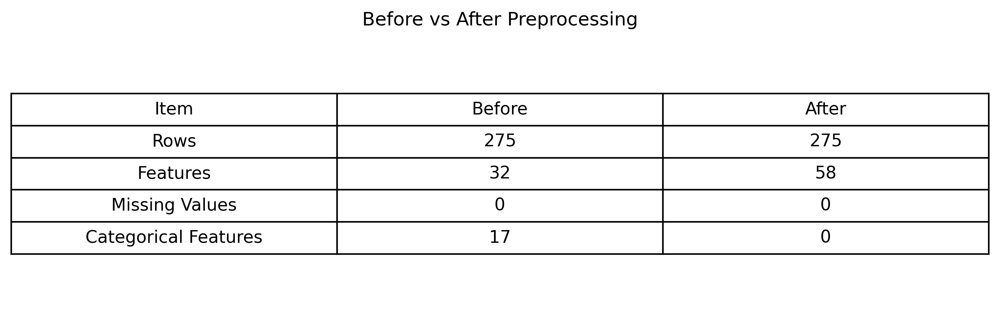

# 🎓 AI 기반 학생 성적 예측 서비스
### Student Performance Predictor

학생의 학습 정보와 이전 성적을 활용하여 최종 성적을 예측하는 머신러닝 웹서비스입니다.

## 0. 프로젝트 정보

- **프로젝트명:** AI 기반 학생 성적 예측 서비스
- **학번:** [202032543]
- **이름:** [변지현]
- **개발 환경:** Google Colab, Python, scikit-learn, Streamlit
- **GitHub URL:** [저장소 주소 입력]
- **Demo URL:** [https://student-performance-predictor-3aryt3ddhnxtf3habf33hd.streamlit.app/]

## 1. 문제 정의

### 1.1 문제 상황 (Who / What / When / Why)

- **Who:** 자신의 학업 성취도를 예측하고 싶은 학생
- **What:** 학습 정보와 이전 성적을 기반으로 최종 성적을 예측하는 서비스
- **When:** 1차·2차 평가 결과가 나온 이후, 최종 성적을 예상하고 싶을 때
- **Why:** 학습 상황을 점검하고 향후 학습 계획을 수립하는 데 참고할 수 있는 정보를 제공하기 위해

### 1.2 기존 서비스와의 차별점

일반적인 성적 조회 서비스가 이미 확정된 성적을 보여주는 데 초점을 맞춘다면, 본 서비스는 머신러닝을 이용하여 아직 확정되지 않은 최종 성적을 예측합니다.

사용자는 이전 성적, 공부 시간, 결석 횟수, 과거 낙제 횟수 등을 입력하고 예측 결과를 확인할 수 있습니다.

### 1.3 정량적 목표

- 테스트 MAE 1.5점 이하
- 테스트 R² 0.75 이상

위 목표는 본 프로젝트의 성능 평가 기준으로 정리한 것입니다. 목표 설정 시점은 최종 제출 전에 정확하게 명시할 예정입니다.

## 2. 데이터

### 2.1 데이터 출처

- 데이터셋: UCI Student Performance Dataset
- 제공기관: UCI Machine Learning Repository
- 데이터 URL: https://archive.ics.uci.edu/dataset/320/student+performance
- 라이선스: CC BY 4.0
- 원저자: Paulo Cortez, Alice Silva

### 2.2 데이터 규모 및 구성

- 사용 데이터: 수학 성적 데이터(student-mat.csv)
- 전체 관측치: 395개
- 전체 변수: 33개
- 입력 변수: 32개
- 예측 대상: 최종 성적 G3(0~20점)

주요 변수는 다음과 같습니다.

| 변수 | 의미 |
|---|---|
| G1 | 1차 성적 |
| G2 | 2차 성적 |
| studytime | 주간 공부 시간 구간 |
| absences | 결석 횟수 |
| failures | 과거 낙제 횟수 |
| G3 | 최종 성적(예측 대상) |

### 2.3 데이터 선정 이유

학생의 성적뿐 아니라 학습 시간, 결석 횟수, 학교생활 및 가정환경 관련 변수가 포함되어 있어 다양한 특성과 최종 성적의 관계를 분석하기에 적합합니다.

또한 정형 데이터로 구성되어 있어 여러 회귀 모델의 성능을 객관적으로 비교할 수 있습니다.

### 2.4 데이터 분포


.png)
  


본 프로젝트에서 사용한 데이터는 총 395명의 학생 성적 데이터로 구성되어 있으며, 최종 성적(G3)은 0~20점 범위로 분포한다. 전체 학생의 평균 최종 성적은 **10.42점**, 중앙값은 **11점**으로 나타났다.

성적 구간별 분포를 분석한 결과, **11~15점 구간이 169명(42.8%)으로 가장 높은 비중**을 차지하였으며, 6~10점 구간은 140명(35.4%), 0~5점 구간은 46명(11.6%), 16~20점 구간은 40명(10.1%)으로 나타났다.

전체 학생의 약 78.2%가 6~15점 구간에 분포하고 있어, 최종 성적이 중간 점수대에 상대적으로 집중되어 있음을 확인하였다. 이러한 데이터 분포는 모델이 중간 점수대의 학생을 상대적으로 많이 학습하게 되는 특성이 있으며, 성적 구간별 예측 오차를 추가로 분석할 필요가 있음을 시사한다.


## 3. 데이터 전처리

### 3.1 결측치 처리

`SimpleImputer`를 활용하여 숫자형 변수에는 중앙값, 범주형 변수에는 최빈값을 적용하도록 구성하였습니다.

원본 데이터의 결측치 여부를 확인한 뒤 실제 대체 여부를 분석하였습니다.

### 3.2 범주형 변수 인코딩

`OneHotEncoder`를 사용하여 문자형 범주 데이터를 머신러닝 모델이 처리할 수 있는 숫자형 변수로 변환하였습니다.

### 3.3 수치형 변수 표준화

`StandardScaler`를 사용하여 숫자형 변수의 평균이 0, 표준편차가 1이 되도록 변환하였습니다.

### 3.4 데이터 분할

| 구분 | 비율 | 데이터 수 |
|---|---|---|
| Train | 약 70% | 276개 |
| Validation | 약 15% | 59개 |
| Test | 약 15% | 60개 |

- Random seed: 42
- 테스트 데이터는 모델 학습 및 하이퍼파라미터 선택에 사용하지 않았습니다.
- 전처리 기준은 학습 데이터에서만 계산하였습니다.

### 3.5 전처리 전후 비교


본 프로젝트에서는 결측치 처리, 원-핫 인코딩, 표준화 기법을 적용하였다.

원-핫 인코딩을 통해 범주형 변수를 숫자형 변수로 변환하였으며, 표준화를 통해 숫자형 변수들의 스케일을 조정하였다.

전처리 과정에서 데이터의 행 개수는 유지되었으며, 변환된 데이터는 머신러닝 모델 학습에 활용되었다.


## 4. 모델

### 4.1 베이스라인 모델: Decision Tree Regressor

의사결정나무는 입력 변수의 조건에 따라 데이터를 반복적으로 분할하여 최종 성적을 예측하는 모델입니다.

- 최대 깊이: 5
- Random seed: 42
- 학습 방식: 직접 지도학습

모델의 구조가 직관적이고 비교적 단순하여 베이스라인으로 선정하였습니다.

### 4.2 제안 모델: Random Forest Regressor

랜덤 포레스트는 여러 의사결정나무의 예측을 결합하는 앙상블 학습 모델입니다.

- 초기 나무 개수: 100
- 초기 최대 깊이: 5
- Random seed: 42
- 학습 방식: 직접 지도학습

단일 의사결정나무의 과적합 위험을 완화하고 예측 성능을 개선할 수 있다는 점에서 제안 모델로 선정하였습니다.

### ### 4.3 모델 개선

랜덤 포레스트 모델의 예측 성능을 개선하기 위해 하이퍼파라미터 튜닝을 수행하였다.

주요 하이퍼파라미터인 `n_estimators`(의사결정나무 개수)와 `max_depth`(나무의 최대 깊이)를 변경하며 총 5가지 조합을 실험하였다.

각 모델은 동일한 학습 데이터로 학습하였으며, 검증 데이터(Validation Set)의 MAE를 기준으로 성능을 비교하였다.

**하이퍼파라미터별 성능 비교**

| 나무 개수 (n_estimators) | 최대 깊이 (max_depth) | Validation MAE |
|---:|---:|---:|
| 50 | 3 | 1.073 |
| 100 | 5 | 1.030 |
| 100 | 8 | 1.000 |
| 200 | 5 | 1.013 |
| **200** | **8** | **0.983** |

**최종 선택된 하이퍼파라미터**

- 최종 나무 개수: **200개**
- 최종 최대 깊이: **8**
- 모델 선택 기준: **Validation MAE 최소화**

초기 랜덤 포레스트 모델(n_estimators=100, max_depth=5)의 Validation MAE는 1.030이었으나, 하이퍼파라미터 튜닝 이후 최종 모델(n_estimators=200, max_depth=8)의 Validation MAE는 0.983으로 감소하였다.

이는 초기 모델 대비 약 **4.6%의 예측 오차 감소**에 해당한다.

따라서 본 프로젝트에서는 검증 데이터에서 가장 낮은 MAE를 기록한 나무 개수 200개, 최대 깊이 8의 랜덤 포레스트를 최종 모델로 선정하였다.
## 5. 평가 결과

### 5.1 검증 데이터 성능

| 모델 | MAE | RMSE |
|---|---:|---:|
| Decision Tree | 1.092 | 2.175 |
| Random Forest (초기 모델) | 1.030 | 1.666 |

### 5.2 최종 테스트 데이터 성능

| 모델 | MAE ↓ | RMSE ↓ | R² ↑ |
|---|---:|---:|---:|
| Decision Tree | 1.273 | 2.443 | 0.730 |
| Random Forest | **1.209** | **2.122** | **0.796** |

### 5.3 최종 모델 선정 이유

랜덤 포레스트는 의사결정나무 대비 MAE를 약 5.0%, RMSE를 약 13.1% 감소시켰으며 R²는 0.066p 높게 나타났습니다.

세 가지 평가 지표에서 모두 우수한 결과를 보여 최종 모델로 선정하였습니다.

### 5.4 오류 분석

다음 방법으로 예측 결과를 분석하였습니다.

1. 실제 성적과 예측 성적의 산점도
2. 예측 오차 분포 히스토그램
3. 절대 오차가 큰 학생 사례 분석

[실제 그래프 2개 이상 삽입]

[오차가 큰 사례와 관찰된 특징 추가]

## 6. 서비스 프로토타입

### 6.1 서비스 개요

Streamlit을 활용하여 학생의 학습 정보와 이전 성적을 입력받고, 학습된 랜덤 포레스트 모델을 통해 최종 성적을 예측하는 웹서비스를 구현하였습니다.

### 6.2 모델 연동 방식

1. 사용자가 학생 정보를 입력합니다.
2. 입력하지 않은 변수에는 학습 데이터에서 계산한 기본값을 적용합니다.
3. 저장된 전처리 도구를 사용하여 입력 데이터를 변환합니다.
4. 학습된 랜덤 포레스트 모델로 최종 성적을 예측합니다.
5. 예측 결과를 0~20점 범위로 표시합니다.

### 6.3 서비스 화면

**화면 1. 학생 정보 입력 화면**


**화면 2. 첫 번째 예측 결과**


**화면 3. 다른 입력값의 예측 결과**


### 6.4 서비스의 한계

본 서비스는 포르투갈 중등학교 학생 데이터를 기반으로 학습되었으므로 다른 국가나 교육환경에 그대로 일반화하기 어렵습니다.

또한 일부 입력 변수에 기본값을 적용하므로 실제 학생의 특성을 완전히 반영하지 못할 수 있습니다.

## 7. 배포

- 배포 플랫폼: Streamlit Community Cloud
- 공개 URL: [Streamlit URL 입력]
- 소스코드 관리: GitHub Public Repository

사용자는 별도의 설치 없이 웹브라우저에서 서비스에 접속하여 최종 성적을 예측할 수 있습니다.

## 8. 실행 방법

### 8.1 실행 환경

- Python: [실제 버전]
- scikit-learn: [실제 버전]
- pandas: [실제 버전]
- numpy: [실제 버전]
- Streamlit
- joblib

### 8.2 실행 방법

저장소를 다운로드한 후 필요한 패키지를 설치합니다.

```bash
pip install -r requirements.txt
```

이후 다음 명령어로 웹서비스를 실행합니다.

```bash
streamlit run app.py
```

### 8.3 모델 파일

- `student_model.pkl`: 학습된 랜덤 포레스트 모델
- `preprocessor.pkl`: 전처리 도구
- `feature_columns.pkl`: 입력 변수 목록
- `default_values.pkl`: 입력 변수 기본값

학습 코드는 별도의 Jupyter Notebook 파일로 제공할 예정입니다.

## 9. Lessons Learned

### 9.1 Plus — 잘된 점

1. 실제 학생 성적 데이터를 이용하여 머신러닝 모델을 직접 학습하고, 두 모델의 성능을 객관적으로 비교할 수 있었습니다.
2. 학습한 모델을 Streamlit 웹서비스에 연결하여 실제 사용자 입력에 대한 예측 기능을 구현하였습니다.

### 9.2 Minus — 아쉬웠던 점

1. 데이터셋의 관측치가 395개로 비교적 적어, 모델 성능의 일반화 가능성에 한계가 있습니다.
2. 웹서비스에서 일부 입력 변수에 기본값을 적용하기 때문에 학생별 특성을 완전히 반영하지 못합니다.

### 9.3 Interesting — 흥미로웠던 점

1. 랜덤 포레스트가 의사결정나무보다 테스트 MAE와 RMSE에서 모두 우수한 결과를 보였습니다.
2. 모델을 학습하는 것과 실제 웹서비스에서 모델을 불러와 사용하는 것은 서로 다른 작업이며, 실행 환경의 호환성이 중요하다는 점을 확인했습니다.

### 9.4 문제 해결 사례

**사례 1. 데이터셋 압축 구조 문제**

- 문제: 데이터셋을 불러오는 과정에서 `KeyError` 발생
- 원인: 다운로드한 ZIP 파일 내부에 추가 ZIP 파일이 존재
- 시도: 내부 ZIP 파일을 먼저 열도록 데이터 로딩 코드 수정
- 결과: 395개 관측치와 33개 변수를 정상적으로 불러옴

**사례 2. 모델 파일 호환성 문제**

- 문제: Streamlit 배포 환경에서 `preprocessor.pkl` 로딩 중 `AttributeError` 발생
- 원인: Python 및 머신러닝 라이브러리의 버전 차이에 따른 호환성 문제로 추정
- 시도: requirements.txt 및 배포 환경 점검, 앱 재시작
- 결과: 웹서비스 정상 실행 및 성적 예측 성공

### 9.5 향후 개선 계획

1. **데이터:** 더 다양한 학교와 학생 집단의 데이터를 확보하여 일반화 성능 검증
2. **모델:** 교차검증 및 추가 회귀 알고리즘 비교를 통해 예측 안정성 개선
3. **서비스:** 사용자 입력 변수를 확대하고 예측 결과에 대한 설명 기능 추가

---

본 프로젝트는 머신러닝 학습 과정의 이해와 서비스 프로토타입 구현을 목적으로 제작되었습니다. 예측 결과는 학업 성취도를 확정하거나 학생을 평가하는 용도로 사용해서는 안 됩니다.
